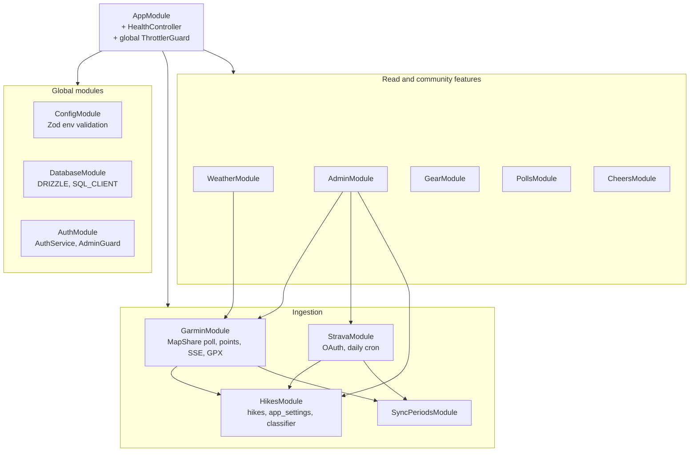
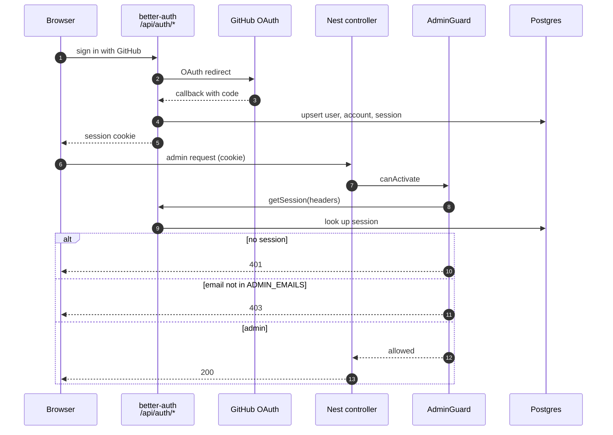
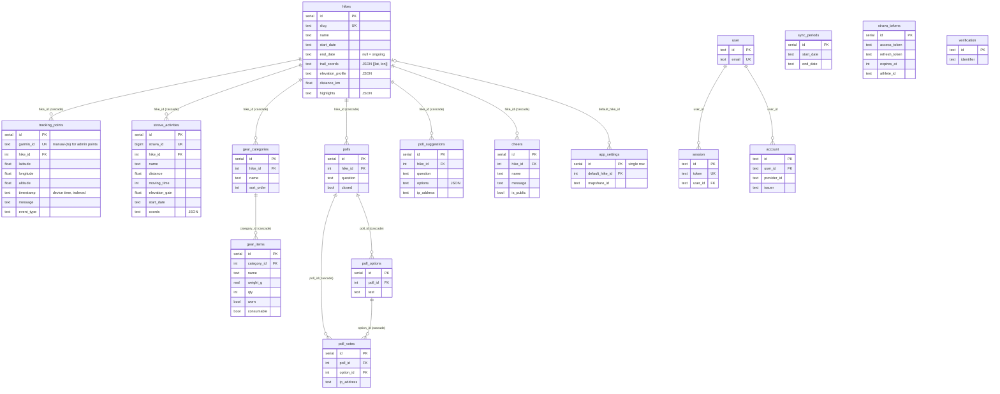
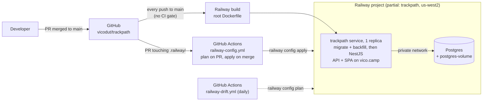

# Trackpath — Architecture

A real-time Appalachian Trail thru-hike tracker with Garmin inReach integration, Strava sync, an interactive map, elevation profiles, trail highlights, and gear/polls/cheers pages for followers.

## System Overview

```
┌─────────────────────────────────────────────────────────┐
│                  Client (React SPA)                      │
│  Vite 8 · React 19 · react-leaflet · CSS Modules         │
└──────────────────────────┬──────────────────────────────┘
                           │ /api/*  (same origin in prod)
┌──────────────────────────▼──────────────────────────────┐
│                  Server (NestJS 11)                       │
│  SWC · better-auth · Drizzle ORM · class-validator        │
└───────┬──────────┬──────────┬──────────┬────────────────┘
        │          │          │          │
   ┌────▼───┐ ┌────▼───┐ ┌────▼──┐ ┌─────▼─────┐
   │Postgres│ │ Garmin │ │Strava │ │Open-Meteo │
   │  (DB)  │ │inReach │ │  API  │ │ (weather) │
   └────────┘ └────────┘ └───────┘ └───────────┘
```

For how data flows between these boxes (ingestion, hike classification, live updates, weather caching), see [`SYSTEM_DESIGN.md`](SYSTEM_DESIGN.md).

## Monorepo Layout

Turborepo + npm workspaces. Three packages:

```
apps/
  api/          # NestJS backend — @trackpath/api
  web/          # Vite React frontend — @trackpath/web
packages/
  db/           # Drizzle schema + migrations — @trackpath/db
```

`apps/web` builds into `apps/api/dist/client`, and the NestJS server serves it
as static files in production — there is one deployable process, not two.

## Data Sources

| Source | What | How |
|--------|------|-----|
| **Garmin inReach** | GPS tracking points (lat, lon, alt, timestamp, messages) | Server polls the MapShare KML feed on an interval (`POLL_INTERVAL_MIN`, default 5 min); the MapShare ID is read from `app_settings` |
| **Strava** | Hiking activities (distance, elevation, GPS traces) | OAuth2 connect, auto-sync daily at midnight (cron), plus manual/date-range sync |
| **OpenStreetMap** | AT trail highlights (shelters, summits, towns, etc.) | Static JSON in `apps/web/public/at-highlights.json`. The same data is also copied into the `hikes` row by the AT backfill, but the SPA still reads the static files |
| **Open-Meteo** | Trail elevation data + weather forecast | Elevation: static `at-trail-elevation.json`. Weather: live at last position, cached server-side for 30 min |

## Client Architecture (`apps/web`)

### Tech Stack
- **React 19** + TypeScript, **Vite 8**
- **react-leaflet** / Leaflet for the interactive map
- **CSS Modules** — one `ComponentName.module.css` per component, no global styles outside `index.css`
- PWA: `public/manifest.json` + `public/sw.js` (app-shell caching, OSM tile caching)
- **better-auth** React client for session/auth state

### File Structure

```
apps/web/src/
├── App.tsx                    # Root component
├── main.tsx                   # Entry point
├── types.ts                   # Shared client types
├── theme.ts                   # Color tokens for JS (Leaflet icons, SVG)
│
├── hooks/
│   ├── usePoints.ts            # Tracking points CRUD, distance/elevation calc
│   ├── useAdmin.ts             # Session + admin check
│   ├── useStrava.ts            # Strava activities, connect, sync
│   ├── useGear.ts              # Gear categories/items CRUD
│   ├── usePolls.ts             # Polls, votes, suggestions
│   ├── useCheers.ts            # Cheers feed + posting
│   ├── useModals.ts            # Modal/page state
│   ├── useAddPoint.ts          # Add point flow (form, coords, submit)
│   ├── useTrailDistance.ts     # Trail-aware distance between two points
│   ├── useUnit.ts              # km/mi unit preference
│   └── useIsMobile.ts          # Responsive breakpoint hook
│
├── api/                        # Thin fetch wrappers per resource
│   ├── points.ts, gear.ts, polls.ts, cheers.ts, syncPeriods.ts
│
├── lib/
│   ├── constants.ts             # TAG_EMOJIS, TAGS, breakpoints
│   ├── geo.ts                   # Haversine distance formula
│   ├── format.ts                # formatDuration and friends
│   ├── stravaHike.ts, tripDays.ts # Strava/hike-day helpers for stats
│   └── auth-client.ts           # better-auth client (better-auth/react)
│
├── data/
│   └── iconic-summits.ts        # Notable AT summits with trail distances
│
├── components/                  # One folder per component
│   ├── Map/                     # Leaflet map + all map sub-components
│   ├── MapElevationProfile/     # Collapsible elevation chart
│   ├── HighlightsLayer/         # AT POI markers
│   ├── Header/                  # Top nav bar + mobile menu
│   ├── Sidebar/                 # Desktop sidebar + mobile drawer
│   ├── AddPointForm/            # Admin form to add tracking points
│   ├── PointCard/, PointPopup/  # Trail-log entry / mobile bottom sheet
│   ├── LayerToggle/             # Map layer visibility controls
│   ├── Weather/                 # Forecast at last position
│   ├── Stats/, StatsPage/       # Compact overlay + full stats page
│   ├── AdminPage/               # Sync controls, status, poll/gear moderation
│   ├── GearPage/                # Gear list (categories, items, CSV import)
│   ├── PollsPage/                # Voting UI + suggestions
│   ├── CheersPage/               # Cheers feed + form
│   ├── ResourcesPage/            # AT links, location-aware forecast button
│   ├── TrailLogPage/              # Mobile full-screen point list
│   ├── LocationBanner/, StatusBar/, CopyCoords/, PoopRain/
│   └── ErrorBoundary/            # Catches React errors, shows reload page
│
└── styles/
    └── index.css                 # Global styles only (root vars, resets, layout)
```

`AdminPage`, `StatsPage`, `GearPage`, `PollsPage`, `CheersPage`, `ResourcesPage`,
and `TrailLogPage` are lazy-loaded to keep them out of the initial bundle.

## Server Architecture (`apps/api`)

### Tech Stack
- **NestJS 11**, compiled with **SWC** (not `tsc`)
- **better-auth** (GitHub OAuth), mounted directly as an Express handler ahead of Nest's own routing (`app.use('/api/auth', toNodeHandler(auth))` in `main.ts`) so it can read raw request bodies before any body parser runs
- **Drizzle ORM** + PostgreSQL, via the workspace package `@trackpath/db`
- **class-validator** / **class-transformer** for request DTOs (global `ValidationPipe({ whitelist: true, transform: true })`)
- **Zod** for env var validation only (`config/env.schema.ts`, fail-fast at boot)
- **@nestjs/throttler**, bound globally via `APP_GUARD` — default 120 req/min, 5 req/min via `@Throttle()` on the two manual sync endpoints
- **@nestjs/schedule** for cron-based background jobs

### File Structure

```
apps/api/src/
├── main.ts                # Bootstrap: better-auth mount, static file serving,
│                           # SPA fallback, ValidationPipe, global /api prefix
├── app.module.ts           # Root module — imports every feature module,
│                           # binds ThrottlerGuard
├── auth.ts                 # better-auth instance config (GitHub OAuth)
├── auth/                   # AuthService (session lookup), AdminGuard
├── garmin/                 # GarminService (MapShare poll + sync, SSE, GPX), controller
├── strava/                 # StravaService (OAuth + activity sync), controller
├── hikes/                  # HikesService, AppSettingsService, HikeClassifierService (no controller)
├── sync-periods/           # SyncPeriodsService + controller (date ranges that limit kept data)
├── common/                 # Pure helpers: UTC day bounds, haversine
├── weather/                # WeatherService (Open-Meteo, 30-min cache), controller
├── gear/                   # GearService + controller (categories + items)
├── polls/                  # PollsService + controller (polls, votes, suggestions)
├── cheers/                 # CheersService + controller (motivation messages)
├── admin/                  # AdminService (dashboard aggregation), controller
├── health/                 # HealthController (/api/health, /api/health/db)
├── config/                 # ConfigModule — Zod env schema + validation
└── database/               # DatabaseModule — global Drizzle + SQL_CLIENT providers
apps/api/scripts/           # One-off dev scripts (seed/delete simulated GPS, fetch elevations/highlights)
```

### Module dependencies

Arrows are NestJS module imports. `ConfigModule`, `DatabaseModule` (`DRIZZLE`) and
`AuthModule` (`AuthService`, `AdminGuard`) are global, so every feature module uses
them without importing them; they are left out of the arrows.



`GearModule`, `PollsModule` and `CheersModule` depend only on the database. Their
tables carry a `hike_id`, but the services don't set or filter on it yet: only
Garmin and Strava data is hike-scoped today.

### API Routes

| Method | Route | Auth | Description |
|--------|-------|------|-------------|
| GET | `/api/health` | No | Health check |
| GET | `/api/health/db` | No | DB connectivity + tracking point count |
| GET | `/api/me` | No | Current session + admin status |
| GET | `/api/points` | No | All tracking points |
| POST | `/api/points` | Admin | Add manual point |
| DELETE | `/api/points/:id` | Admin | Delete point |
| POST | `/api/sync` | Admin | Manual/date-range Garmin sync |
| GET | `/api/sync-status` | No | Polling status |
| GET | `/api/stream` | No | SSE stream of new points |
| GET | `/api/export.gpx` | No | GPX export of the trail |
| GET | `/api/weather` | No | Forecast at last position |
| GET | `/api/admin/sync-periods` | No | List sync periods (read by the public location banner) |
| POST/DELETE | `/api/admin/sync-periods[/:id]` | Admin | Add or remove a sync period |
| GET | `/api/strava/status` | No | Strava connection status |
| GET | `/api/strava/activities` | No | All synced Strava activities |
| GET | `/api/strava/connect` | Admin | Start Strava OAuth |
| GET | `/api/strava/callback` | No | Strava OAuth callback |
| POST | `/api/strava/sync` | Admin | Manual/date-range Strava sync |
| GET | `/api/gear` | No | Gear categories + items |
| POST/PUT/DELETE | `/api/gear/categories[/:id]` | Admin | Manage gear categories |
| POST/PUT/DELETE | `/api/gear/items[/:id]` | Admin | Manage gear items |
| POST | `/api/gear/import` | Admin | Bulk CSV import |
| GET | `/api/polls` | No | Open/closed polls with vote counts |
| POST | `/api/polls` | Admin | Create a poll |
| POST | `/api/polls/:id/vote` | No (one vote per IP) | Vote on a poll |
| PATCH | `/api/polls/:id/close` | Admin | Close a poll |
| DELETE | `/api/polls/:id` | Admin | Delete a poll |
| GET/POST | `/api/polls/suggestions` | Admin (GET) / No (POST) | Follower-suggested polls |
| POST/DELETE | `/api/polls/suggestions/:id[/accept]` | Admin | Accept or reject a suggestion |
| GET | `/api/cheers` | No | Today's public cheers |
| GET | `/api/cheers/all` | Admin | Full cheers history |
| POST | `/api/cheers` | No (global 120 req/min only) | Post a cheer |
| DELETE | `/api/cheers/:id` | Admin | Delete a cheer |
| GET | `/api/admin/status` | Admin | Dashboard aggregation (sync status, pending suggestions, etc.) |
| ALL | `/api/auth/*` | No | better-auth handlers (GitHub OAuth, session) |

"Admin" = `AdminGuard`, which requires a valid better-auth session whose email
is in `ADMIN_EMAILS`. An empty list means no one is an admin.

### Background Jobs
- **Garmin auto-poll**: `setInterval`, every `POLL_INTERVAL_MIN` minutes (default 5), registered via `SchedulerRegistry` — runs once at boot, then each tick no-ops unless a MapShare ID is set in `app_settings` (seeded once from `MAPSHARE_ID` by the AT backfill; shown read-only in the admin panel, no API route edits it)
- **Strava auto-sync**: `@Cron('0 0 * * *')` — daily at midnight server time, skipped when Strava credentials are unset

Both jobs live in the single API process (`replicas: 1` in `.railway/railway.ts`); a second replica would poll twice.

### Auth

better-auth owns `/api/auth/*`: `main.ts` mounts its Node handler before Nest's body
parser. Nest controllers never see those routes. Admin-only handlers carry
`@UseGuards(AdminGuard)`; everything else is public.



### Security
- Session auth via better-auth (GitHub OAuth); admin write endpoints gated by `AdminGuard` + `ADMIN_EMAILS`
- Global rate limiting via `ThrottlerGuard` (120 req/min default), 5 req/min on the two manual sync endpoints (`POST /api/sync`, `POST /api/strava/sync`)
- `ValidationPipe({ whitelist: true, transform: true })` strips unknown fields and coerces types on every request body
- Env vars fail-fast validated with Zod at boot (`config/env.schema.ts`) — the app refuses to start with missing/malformed config

## Database Schema (`packages/db/src/schema.ts`)

`schema.ts` is the source of truth; this diagram shows tables, keys and relations,
not every column. Dates in `hikes`, `sync_periods`, `tracking_points.timestamp` and
`strava_activities.start_date` are ISO 8601 `text`, not `timestamp`.



- **`hikes`** organise everything: `HikeClassifierService` attributes each Garmin point and
  Strava activity to the hike whose date range covers its device timestamp (trail
  proximity breaks overlaps). Data no hike covers is never inserted. `hike_id` is
  nullable at the DB level only to avoid a not-null migration on live data.
- **`app_settings`** is a single global row: the default hike that public reads resolve
  to, and the Garmin MapShare ID.
- **`sync_periods`** are global (not per hike). When any exist, synced points and
  activities outside all of them are pruned; manual points are kept.
- **`tracking_points`** are the source of truth for coordinates and are never mutated
  once written (only inserted, pruned, or deleted by an admin).
- **better-auth tables** (`user`, `session`, `account`, `verification`) are managed by
  better-auth. `account.issuer` (migration `0007`) is a synthetic key
  (`local:oauth:<providerId>`) better-auth 1.7+ uses instead of the raw `provider_id`.

Migrations live in `packages/db/drizzle/` (currently 10, `0000`–`0009`) and are
generated with `npm run db:generate` — never hand-edited. `0006` and `0007` are custom
data migrations (reformat malformed Garmin timestamps, backfill `account.issuer`);
`0008` adds `sync_periods`, `0009` adds `hikes`, `app_settings` and the `hike_id`
columns. `npm run migrate` then runs `packages/db/src/backfill-at-hike.ts`, an
idempotent script that creates the `at` hike from the bundled AT JSON files on first
run, points `app_settings` at it, and backfills `hike_id` on existing rows.

## Deployment (Railway)

Multi-stage `Dockerfile`:
1. **Builder** (`node:22`): deletes and regenerates `package-lock.json`, installs
   with `npm install --ignore-engines`, runs `turbo build` (builds `packages/db`
   → `apps/api` + `apps/web` in parallel; the web build's output lands in
   `apps/api/dist/client`).
2. **Production** (`node:22-slim`): `npm ci --omit=dev`, copies the compiled
   `apps/api/dist` and `packages/db/dist`, plus `packages/db/src` + `drizzle/`
   (needed at runtime by the migration script, which runs via `tsx`), and the three
   `apps/web/public/at-*.json` files read by the AT backfill.

Container start command: `npm run migrate && npm run start` — migrations and the
AT backfill run before the server boots on every deploy.



The Railway project also hosts unrelated apps; `.railway/railway.ts` declares only
trackpath's resources (the `trackpath` partial).

The project configuration is code: `.railway/railway.ts` (Railway IaC, `railway/iac`
SDK), applied with `railway config plan` / `railway config apply`. Secrets stay in Railway
as `preserve()`. See `docs/adr/0001-railway-infrastructure-as-code.md`.

## Development

```bash
git clone <repo>
cp .env.example .env    # fill in secrets
npm install
npm run dev              # turbo dev → db watcher + nest --watch (3001) + vite (5173)
```

### Available Scripts
| Script | Description |
|--------|-------------|
| `npm run dev` | Start API (watch) + web dev server + db type watcher |
| `npm run build` | `turbo build` — packages/db → apps/api + apps/web in parallel |
| `npm run start` | Production start (`node apps/api/dist/main.js`) |
| `npm run migrate` | Run pending Drizzle migrations, then the idempotent AT backfill |
| `npm test` | Jest unit tests (`apps/api` only) |
| `npm run type-check` | TypeScript check across all packages |
| `npm run lint` | ESLint (flat config, `strictTypeChecked`) across all packages |
| `npm run db:generate` | Generate SQL migration from schema changes |
| `npm run db:migrate` | `drizzle-kit migrate` (no backfill; prefer `npm run migrate`) |
| `npm run db:studio` | Drizzle Studio |

Local Postgres via `docker-compose.yml` (`postgres:16-alpine`, matches `.env.example`'s `DATABASE_URL`).

---

See `IMPROVEMENT_SPEC.md` for an audited backlog of known gaps (security, testing/CI, dependency drift) as of the last full review. It is a dated snapshot: its top five (better-auth CVE, unbound throttler, broken lint config, failing type-check, no tests) have since been addressed, except that there is still no CI for code.
