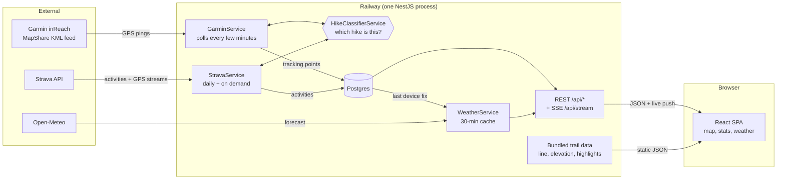
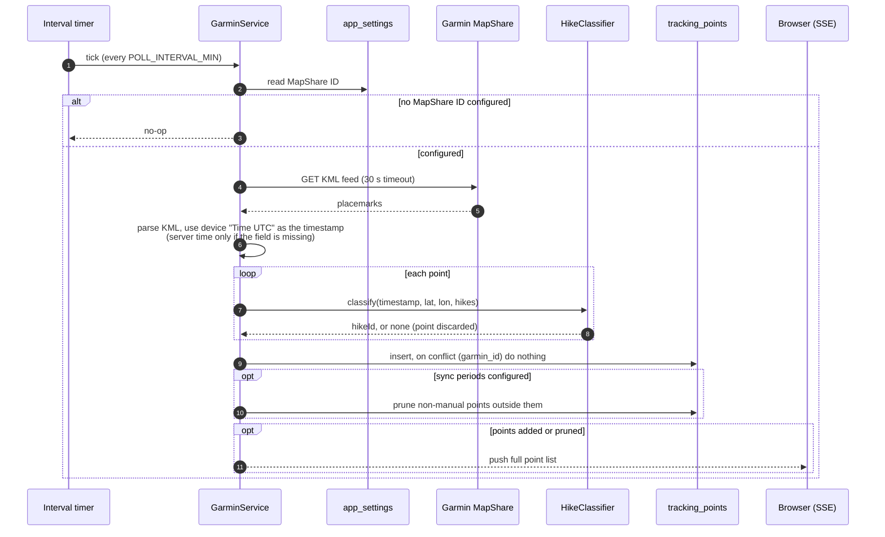

# Trackpath — System Design

How data moves through Trackpath: from a satellite ping on the trail to a dot on the map.

For the module-by-module breakdown, routes, and schema, see [`ARCHITECTURE.md`](ARCHITECTURE.md).

## Overview

1. **Garmin ingestion.** The server polls the hiker's Garmin MapShare feed on an interval, attributes each GPS ping to a hike, and stores it.
2. **Strava ingestion.** Once a day (or on demand) the server pulls Strava activities and their GPS traces through the same hike classifier.
3. **Read path.** The browser loads tracking points and activities over REST, then keeps a server-sent-events stream open so new pings appear without a refresh.
4. **Weather.** The server looks up the latest device position, asks Open-Meteo for a forecast there, and caches it for 30 minutes.
5. **Static trail data.** The trail line, elevation profile, and points of interest are precomputed JSON files shipped with the frontend. No database or API is involved.

## For developers

### Flow reference

| Flow | Trigger & cadence | Code entry point | Tables read → written | Failure behaviour |
|---|---|---|---|---|
| **Garmin ingestion** | `setInterval` every `POLL_INTERVAL_MIN` minutes (default 5), plus once at boot. Manual `POST /api/sync` (admin, optional date range, 5 req/min). | `GarminService.autoSync` / `syncFromMapShare` in `apps/api/src/garmin/garmin.service.ts` | `app_settings` (MapShare ID), `hikes`, `sync_periods` → `tracking_points` (insert, deduped on `garmin_id`; when sync periods are configured, non-manual points outside all of them are pruned) | 30 s fetch timeout. Auto-poll errors are caught, recorded in the admin sync log and sync status, and the loop keeps running. Manual sync returns 400 with no MapShare ID configured and 500 on fetch/parse errors. Points no hike covers are discarded and counted in the sync log. |
| **Strava ingestion** | One-time OAuth connect (`GET /api/strava/connect` → `/api/strava/callback`) stores tokens. Then `@Cron('0 0 * * *')`, daily at midnight server time (skipped if `STRAVA_CLIENT_ID` / `STRAVA_CLIENT_SECRET` are unset), plus manual `POST /api/strava/sync` (admin, optional date range, 5 req/min). | `StravaService.handleCallback`, `autoSync` / `syncActivities` in `apps/api/src/strava/strava.service.ts` | `strava_tokens`, `hikes`, `sync_periods` → `strava_activities` (insert new by `strava_id`, backfill coords for rows missing GPS; when sync periods are configured, rows outside all of them are pruned), `strava_tokens` (written on connect, refreshed near expiry) | Fetches up to 200 activities per run. Token is refreshed 5 min before expiry. Not connected or a non-2xx Strava response returns an error (400 on manual sync, sync-log entry on cron). A failed GPS stream stores empty coords, which the next sync backfills. Cron errors are swallowed into the sync log. |
| **Read path** | Points: on page load, then pushed over SSE on every change. Strava activities: fetched once on page load (no push). | `GarminController` (`/api/points`, `/api/stream`) and `StravaController` (`/api/strava/activities`); client in `apps/web/src/hooks/usePoints.ts` and `useStrava.ts` | `app_settings` (default hike), `tracking_points`, `strava_activities` → nothing | The SSE stream re-sends the full point list on connect and after any sync or edit that changes points. On error the client reconnects with exponential backoff (2 s → 30 s). |
| **Weather** | On request, `GET /api/weather` (widget mount). | `WeatherService.getForecast` in `apps/api/src/weather/weather.service.ts` | `tracking_points` (latest non-manual point) → nothing; in-memory cache | Single in-memory slot, reused for 30 min while the latest position is unchanged; replaced when it moves; lost on restart. With no tracking points it returns `{ error }` and the widget hides itself. The Open-Meteo call has no timeout and no `res.ok` check: network errors surface as a 500, and a non-2xx JSON body is cached as a forecast-less result. |
| **Static trail data** | Fetched by the browser on load. | `apps/web/public/at-trail.json`, `at-trail-elevation.json`, `at-highlights.json`; served by Vite in dev and by NestJS `express.static` in production | none | Each fetch has a `.catch`: the affected layer or profile simply doesn't render. |

Configuration referenced above: `POLL_INTERVAL_MIN`, `STRAVA_CLIENT_ID`, `STRAVA_CLIENT_SECRET`. The Garmin MapShare ID lives in the `app_settings` table and is edited from the admin panel.

### Garmin ingestion, step by step

