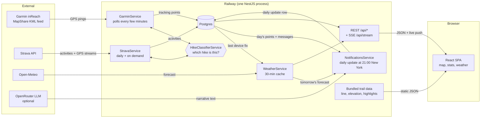
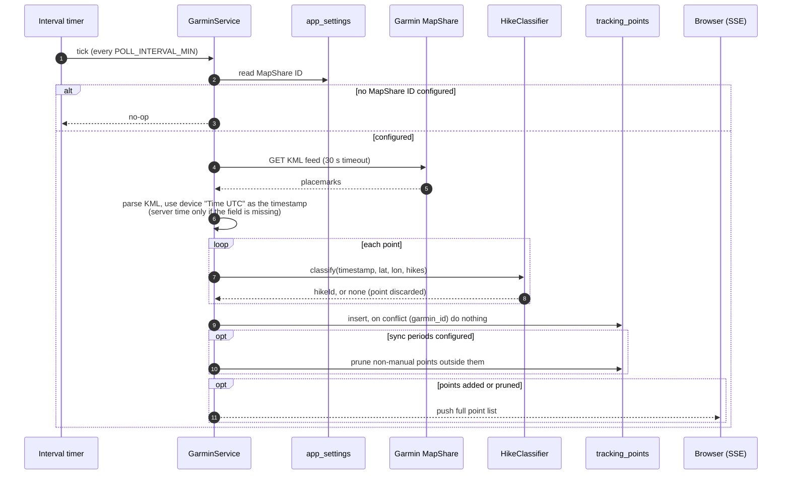
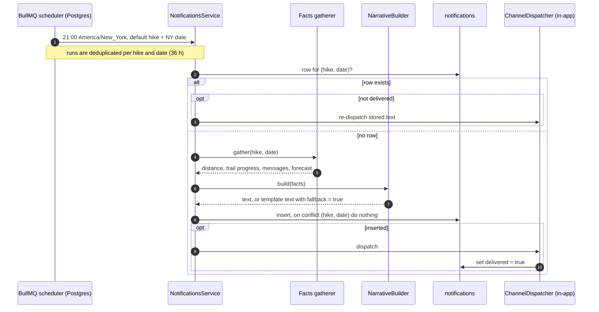

# Trackpath — System Design

How data moves through Trackpath: from a satellite ping on the trail to a dot on the map.

For the module-by-module breakdown, routes, and schema, see [`ARCHITECTURE.md`](ARCHITECTURE.md).

## Overview

1. **Garmin ingestion.** The server polls the hiker's Garmin MapShare feed on an interval, attributes each GPS ping to a hike, and stores it.
2. **Strava ingestion.** Once a day (or on demand) the server pulls Strava activities and their GPS traces through the same hike classifier.
3. **Read path.** The browser loads tracking points and activities over REST, then keeps a server-sent-events stream open so new pings appear without a refresh.
4. **Weather.** The server looks up the latest device position, asks Open-Meteo for a forecast there, and caches it for 30 minutes.
5. **Daily update.** Every evening at 21:00 New York time the server gathers the day's facts (distance, trail progress, messages, tomorrow's forecast), turns them into a short message (through an LLM when configured, a template otherwise), stores it as one row per hike and day, and marks it delivered. The app's notifications pane reads that history.
6. **Static trail data.** The trail line, elevation profile, and points of interest are precomputed JSON files shipped with the frontend. No database or API is involved.

## For developers

### Flow reference

| Flow | Trigger & cadence | Code entry point | Tables read → written | Failure behaviour |
|---|---|---|---|---|
| **Garmin ingestion** | `setInterval` every `POLL_INTERVAL_MIN` minutes (default 5), plus once at boot. Manual `POST /api/sync` (admin, optional date range, 5 req/min). | `GarminService.autoSync` / `syncFromMapShare` in `apps/api/src/garmin/garmin.service.ts` | `app_settings` (MapShare ID), `hikes`, `sync_periods` → `tracking_points` (insert, deduped on `garmin_id`; when sync periods are configured, non-manual points outside all of them are pruned) | 30 s fetch timeout. Auto-poll errors are caught, recorded in the admin sync log and sync status, and the loop keeps running. Manual sync returns 400 with no MapShare ID configured and 500 on fetch/parse errors. Points no hike covers are discarded and counted in the sync log. |
| **Strava ingestion** | One-time OAuth connect (`GET /api/strava/connect` → `/api/strava/callback`) stores tokens. Then `@Cron('0 0 * * *')`, daily at midnight server time (skipped if `STRAVA_CLIENT_ID` / `STRAVA_CLIENT_SECRET` are unset), plus manual `POST /api/strava/sync` (admin, optional date range, 5 req/min). | `StravaService.handleCallback`, `autoSync` / `syncActivities` in `apps/api/src/strava/strava.service.ts` | `strava_tokens`, `hikes`, `sync_periods` → `strava_activities` (insert new by `strava_id`, backfill coords for rows missing GPS; when sync periods are configured, rows outside all of them are pruned), `strava_tokens` (written on connect, refreshed near expiry) | Fetches up to 200 activities per run. Token is refreshed 5 min before expiry. Not connected or a non-2xx Strava response returns an error (400 on manual sync, sync-log entry on cron). A failed GPS stream stores empty coords, which the next sync backfills. Cron errors are swallowed into the sync log. |
| **Read path** | Points: on page load, then pushed over SSE on every change. Strava activities: fetched once on page load (no push). | `GarminController` (`/api/points`, `/api/stream`) and `StravaController` (`/api/strava/activities`); client in `apps/web/src/hooks/usePoints.ts` and `useStrava.ts` | `app_settings` (default hike), `tracking_points`, `strava_activities` → nothing | The SSE stream re-sends the full point list on connect and after any sync or edit that changes points. On error the client reconnects with exponential backoff (2 s → 30 s). |
| **Weather** | On request, `GET /api/weather` (widget mount). | `WeatherService.getForecast` in `apps/api/src/weather/weather.service.ts` | `tracking_points` (latest non-manual point) → nothing; in-memory cache | Single in-memory slot, reused for 30 min while the latest position is unchanged; replaced when it moves; lost on restart. With no tracking points it returns `{ error }` and the widget hides itself. The Open-Meteo call has no timeout and no `res.ok` check: network errors surface as a 500, and a non-2xx JSON body is cached as a forecast-less result. |
| **Daily update** | BullMQ job scheduler on the Postgres backend (no Redis), cron `0 21 * * *` in `America/New_York`, upserted at boot. Also a catch-up run on every API startup. `GET /api/notifications` (public) reads the history. | `DailyUpdateScheduler` in `apps/api/src/daily-update/daily-update.scheduler.ts` → `NotificationsService.runDailyUpdateFor` / `runDailyUpdate` in `apps/api/src/notifications/notifications.service.ts` | `hikes`, `app_settings`, `tracking_points`, `notifications` → `notifications` (insert one row per hike and New York date, then `delivered` flag) | Unique `(hike_id, date)` makes a run idempotent: a second run, or a concurrent one, inserts nothing and dispatches nothing. A row saved but not delivered is re-dispatched on the next run without gathering or building again. A failing channel is logged and leaves the row undelivered. Narrative failure falls back to a template (`fallback = true`). The startup catch-up swallows errors so the API still boots. |
| **Static trail data** | Fetched by the browser on load. | `apps/web/public/at-trail.json`, `at-trail-elevation.json`, `at-highlights.json`; served by Vite in dev and by NestJS `express.static` in production | none | Each fetch has a `.catch`: the affected layer or profile simply doesn't render. |

Configuration referenced above: `POLL_INTERVAL_MIN`, `STRAVA_CLIENT_ID`, `STRAVA_CLIENT_SECRET`, `OPENROUTER_API_KEY`, `OPENROUTER_MODEL`. The Garmin MapShare ID lives in the `app_settings` table. It is seeded once from the `MAPSHARE_ID` env var when `npm run migrate` first creates the AT hike (`packages/db/src/backfill-at-hike.ts`); the admin panel shows it read-only, and no API route edits it yet.

### Garmin ingestion, step by step

### Daily update, step by step

- **Scheduler.** `DailyUpdateScheduler` upserts a BullMQ job scheduler at boot (`0 21 * * *`, `America/New_York`), so restarts and multiple instances converge on one schedule. Each tick resolves the default hike (`app_settings.default_hike_id`; none means the tick is skipped with a warning) and the New York date, then enqueues a run job keyed by hike and date with a 36 h deduplication window. The run calls `NotificationsService.runDailyUpdateFor`, which does nothing when the date is outside the hike's date range.
- **Gather facts.** `DailyFactsGatherer` composes the distance, trail-progress, messages and forecast providers. Messages and the signal flag cover midnight to 21:00 New York by device timestamp. The forecast is tomorrow's from `WeatherService`, else the day's; it is `null` when Open-Meteo has none or fails, and the weather line is then dropped.
- **Build message.** `NarrativeBuilder` asks an OpenRouter model (`OPENROUTER_API_KEY` and `OPENROUTER_MODEL` both set) for 2 to 4 sentences, with a 20 s timeout and up to 2 retries (1 s, 2 s backoff). With the feature off, or after every attempt fails or returns empty text, it uses a template built from the same facts and the row gets `fallback = true`.
- **Store and dispatch.** The row (facts snapshot, text, `fallback`) is inserted, then `ChannelDispatcher` calls each channel. Only the in-app channel exists; it sets `delivered = true`, because the pane reads the stored rows.
- **Retry.** There is no separate retry job: an undelivered row is re-dispatched only when a run for that same hike and New York date happens again, in practice the startup catch-up on that date. Older undelivered rows are not retried.
- **Catch-up on startup.** `NotificationsService.onApplicationBootstrap` runs the daily update for every hike active on the current New York date, so a day missed during downtime is generated, or an undelivered row re-dispatched, when the API comes back. This can also run before 21:00, in which case it uses the facts available at that moment.
